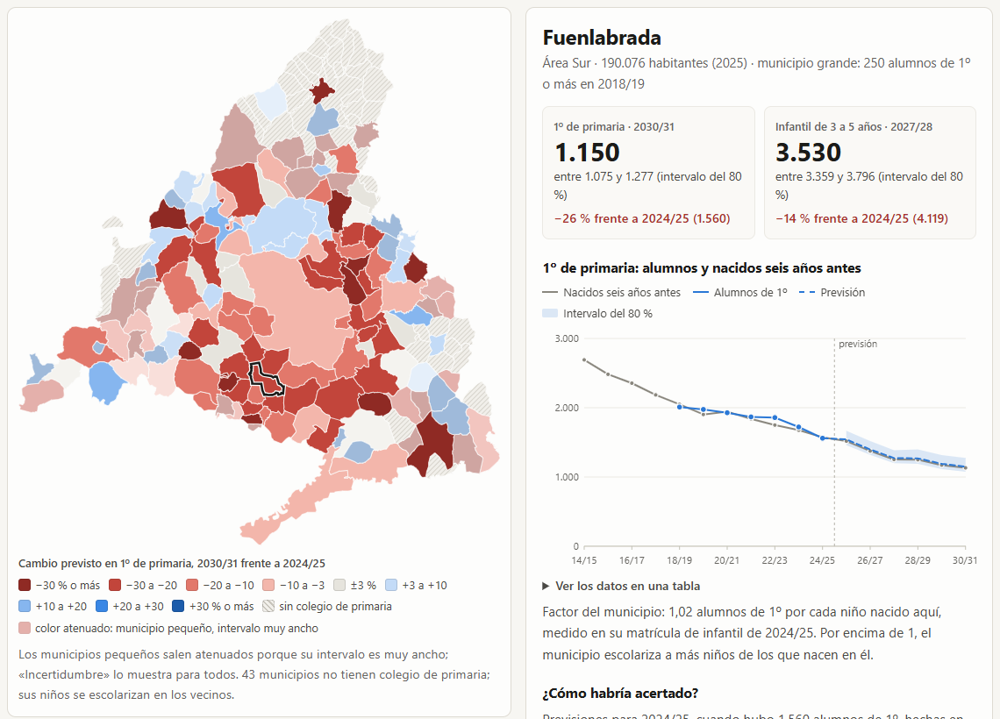

# Radar de natalidad municipal

Previsión abierta de cuántos niños entrarán en 1º de primaria y en infantil (3 a 5 años) en cada municipio de la Comunidad de Madrid durante los próximos cursos, con un intervalo de incertidumbre que sale de los errores reales del método en cursos ya cerrados. Todo se calcula con datos del catálogo de datos abiertos de la Comunidad de Madrid y se puede rehacer desde cero con una orden.

Proyecto para DataMad 2026. Código con licencia MIT.



## Qué hace

- Descarga de su URL oficial siete recursos del catálogo regional y deja constancia de la URL, la fecha, el tamaño y la huella SHA-256 de cada uno en [`fuentes/manifiesto.json`](fuentes/manifiesto.json).
- Calcula, para los 136 municipios con colegio de primaria, los alumnos previstos de 1º hasta el curso 2030/31 y los de infantil de 2º ciclo hasta 2027/28, con intervalos del 80 %.
- Pone a prueba el método con un backtest de origen móvil (se prevé como si estuviéramos en un curso pasado, solo con lo que se sabía entonces) y publica el error por tamaño de municipio y por antelación, incluido dónde falla.
- Genera una web estática (carpeta [`web/`](web/)) con un mapa por municipio, una ficha con la serie, la previsión y cómo habría acertado el método en ese municipio, y las tablas de error. Funciona sin servidor y sin conexión: basta abrir `web/index.html`.

## Resultados (versión del 5-nov-2026)

Las cifras salen de [`resultados/resumen.json`](resultados/resumen.json) y se regeneran con cada ejecución.

- 1º de primaria en la región: de 58.859 alumnos en 2024/25 a unos 52.047 en 2030/31 (intervalo del 80 %: 46.545-57.471), un 11,6 % menos. Madrid capital, −5,7 %; resto de la región, −16,1 %; área Sur, −21,0 %. Caen 97 de los 136 municipios con colegio.
- Comprobación con un dato que el modelo no usa: para 2025/26 prevé 56.969 alumnos de 1º; la cifra provisional que publica el Instituto de Estadística es 56.482 (+0,9 %, dentro del intervalo).
- Error en municipios grandes (250 alumnos de 1º o más), a cinco cursos vista: 4,3 % de error mediano, frente al 16,1 % de suponer que nada cambia y al 13,6 % de contar solo los nacidos.
- Infantil de 3 a 5 años en la región: de 159.467 alumnos en 2024/25 a unos 152.536 en 2027/28 (−4,3 %).
- Donde más cae 1º de primaria (municipios con 100 alumnos o más): Paracuellos de Jarama (−39 %), Guadarrama (−37 %) y Arroyomolinos (−34 %). Donde sube: Moralzarzal (+12 %), Villalbilla (+11 %) y Colmenar Viejo (+8 %). La tabla completa está en [`resultados/ranking_ultimo_curso.csv`](resultados/ranking_ultimo_curso.csv).

## Datos

Todos los recursos son del catálogo de datos abiertos de la Comunidad de Madrid ([datos.comunidad.madrid](https://datos.comunidad.madrid), API CKAN) y tienen licencia Creative Commons Attribution (`cc-by` en sus metadatos). No hace falta ninguna fuente del INE ni de fuera de la región. Descarga de esta versión: 5-nov-2026, entre las 09:48 y las 09:49 UTC.

| Recurso | Dataset (página) | Editor | Actualizado en el portal | Para qué |
|---|---|---|---|---|
| [Nacidos vivos por lugar de residencia de la madre y sexo. Municipios](https://datos.comunidad.madrid/dataset/12b40587-add2-4467-b2a0-205b8b99af7d/resource/00a2fcf4-671f-4ea8-8cde-ac56d2dd352f/download/nacidos-vivos-por-lugar-de-residencia-de-la-madre-y-sexo.-municipios.csv) | [`mnp_nacidos_vivos_por_residencia_y_sexo`](https://datos.comunidad.madrid/dataset/mnp_nacidos_vivos_por_residencia_y_sexo) | Instituto de Estadística de la Comunidad de Madrid | 27-11-2025 | Nacidos por municipio, 1985-2024 |
| [Alumnos matriculados en Educación Primaria por curso y sexo](https://datos.comunidad.madrid/dataset/5dd00f2c-2147-4550-b40e-adb5a0b2001c/resource/9073f828-f094-4914-a3a9-69431703b6ef/download/alumnos_primaria_por_curso_y_sexo.csv) | [`spacm_estadisticas_alumnos`](https://datos.comunidad.madrid/dataset/spacm_estadisticas_alumnos) | Consejería de Educación, Ciencia y Universidades | 22-07-2026 | Alumnos de 1º por municipio, cursos 2018/19-2024/25 (Madrid capital, por distritos: se suman) |
| [Alumnos matriculados en Enseñanzas de Régimen General por enseñanzas, titularidad y régimen de financiación](https://datos.comunidad.madrid/dataset/5dd00f2c-2147-4550-b40e-adb5a0b2001c/resource/2fd0545c-4da7-447a-9009-57c64399a49e/download/alumnos_regimen_general_por_titularidad_y_financiacion.csv) | [`spacm_estadisticas_alumnos`](https://datos.comunidad.madrid/dataset/spacm_estadisticas_alumnos) | Consejería de Educación, Ciencia y Universidades | 22-07-2026 | Alumnos de infantil de 2º ciclo por municipio: factor del modelo y previsión de infantil |
| [Alumnos matriculados en educación primaria por curso, titularidad del centro y sexo](https://datos.comunidad.madrid/dataset/baeeb634-fec7-4ac5-b065-f8ea25d28f9f/resource/efc9bf2d-d760-44d5-94f7-0d9ed0e26a45/download/alumnos-matriculados-en-educacion-primaria-por-curso-titularidad-del-centro-y-sexo.csv) | [`alumnos_matriculados_primaria_por_curso_titularidad_y_sexo`](https://datos.comunidad.madrid/dataset/alumnos_matriculados_primaria_por_curso_titularidad_y_sexo) | Instituto de Estadística de la Comunidad de Madrid | 16-09-2026 | 1º regional 1999/00-2025/26: backtest largo y el dato de 2025/26 que el modelo no ve |
| [Población censada por edad, nacionalidad y sexo. Censo anual. Municipios](https://datos.comunidad.madrid/dataset/0a14fbfe-783e-4de3-81b1-ff3792bfd402/resource/bab16922-8df1-49b5-9791-aed4edf8ced1/download/poblacion-censada-por-edad-nacionalidad-y-sexo.-censo-anual.-municipios.csv) | [`poblacion_censada_por_edad_nacionalidad_y_sexo`](https://datos.comunidad.madrid/dataset/poblacion_censada_por_edad_nacionalidad_y_sexo) | Instituto de Estadística de la Comunidad de Madrid | 17-02-2026 | Niños de 0-4 años censados frente a nacidos: señal de llegada de familias y análisis de dónde falla |
| [Población empadronada por sexo. Municipios](https://datos.comunidad.madrid/dataset/bf0b4159-21f8-42fa-835c-d0dc6bc5fadf/resource/bc69f395-1f96-4fc2-a115-025c55b905ad/download/poblacion-empadronada-por-sexo.-municipios.csv) | [`padron_por_sexo`](https://datos.comunidad.madrid/dataset/padron_por_sexo) | Instituto de Estadística de la Comunidad de Madrid | 08-10-2026 | Habitantes de cada municipio (contexto) |
| [Municipios y Distritos de Madrid (2020), shapefile](https://datos.comunidad.madrid/dataset/6c63b14c-9f5d-414f-958f-b8a9c53d69fc/resource/3f4435b7-ecdb-4c1e-961a-dd55506c2e10/download/municipios_y_distritos_madrid_20.zip) | [`covid19_tia_muni_y_distritos`](https://datos.comunidad.madrid/dataset/covid19_tia_muni_y_distritos) | Consejería de Sanidad (Red de Vigilancia Epidemiológica) | 03-06-2024 | Límites municipales del mapa (ETRS89 / UTM 30N); los 21 distritos de la capital se funden en uno |

Comprobaciones que hace el código al cargar: la capital solo viene por distritos en la matrícula, los códigos de municipio casan entre fuentes (4 dígitos del Instituto de Estadística → código INE de 5 dígitos) y el total de 1º de primaria de la Consejería coincide alumno a alumno con el del Instituto de Estadística en cada curso de 2018/19 a 2024/25 (diferencia 0).

Lo que no está en el catálogo y limita el radar: plazas ofertadas por centro, nacimientos por distrito de la capital, proyecciones oficiales de alumnado o de población por municipio y flujos migratorios de 0 a 5 años por municipio.

## Método

Un niño que empieza 1º de primaria en el curso *t/t+1* cumple 6 años en *t*, así que nació en *t−6*. Los nacimientos de 2024 ya están publicados, de modo que se puede prever 1º de primaria hasta 2030/31 sin suponer nada sobre la natalidad futura.

No basta con los nacidos: se cuentan por residencia de la madre y los alumnos por municipio del colegio, hay familias que se mudan con niños pequeños y pueblos que escolarizan a los de su comarca. Por eso cada municipio lleva un factor propio medido en su matrícula:

```
previsión de 1º (curso t, base b) = nacidos(t−6) × F_m(b) × k(b)

F_m(b) = alumnos de infantil de 3-5 años del municipio en b / nacidos del municipio en b−5, b−4 y b−3
k(b)   = [1º regional en b / nacidos regionales en b−6] / [infantil regional en b / nacidos regionales en b−5..b−3]
```

F recoge la llegada y salida de familias y la escolarización cruzada en las tres cohortes más jóvenes ya escolarizadas; k corrige, con datos regionales de la misma base, la diferencia media entre la razón de infantil y la de 1º (k = 1,0227 en 2024/25). Si un municipio no tiene infantil de 2º ciclo, se usa la razón de 1º de sus tres últimos cursos (hoy no ocurre en ninguno).

Para infantil de 3 a 5 años: nacidos de las tres cohortes × razón alumnos/nacidos del municipio en el último curso. Se puede prever hasta 2027/28 (la cohorte más joven, nacida en 2024, tiene 3 años en 2027).

Incertidumbre: para cada grupo de tamaño y antelación *h* se toman los cuantiles del 10 % y del 90 % del error logarítmico log(real/previsto) del backtest, agrupando *h* con sus vecinos ±1. La capital usa los de los municipios grandes. Para el total regional se usan los errores de la serie regional larga (1999/00-2025/26), que incluye cambios de ciclo migratorio.

### Backtest

- Origen móvil con bases 2018/19 a 2023/24 y horizontes de 1 a 6 cursos. La previsión hecha en la base *b* solo usa alumnado de cursos ≤ *b* y nacidos ≤ *b*. Un test lo comprueba multiplicando todos los datos posteriores a la base y verificando que las previsiones no cambian (`tests/test_modelo.py::test_sin_fuga_del_futuro`).
- Grupos fijos según los alumnos de 1º en 2018/19, el primer curso: grande, 250 o más (36 municipios); mediano, 50-249 (44); pequeño, menos de 50 (54); Madrid capital, aparte.
- Métricas: error absoluto en % (mediana y media), WAPE (pesa por tamaño) y sesgo. Todas las especificaciones se comparan sobre la misma muestra.
- Selección: probé diez especificaciones ([`resultados/seleccion_especificacion.csv`](resultados/seleccion_especificacion.csv)) y me quedé con la de menor error mediano medio a 2-6 cursos en los municipios con 50 alumnos de 1º o más (6,0 %, frente al 6,8 % de las dos siguientes y al 15,2 % del método ingenuo). Ese criterio y tres de las variantes los añadí después de ver los primeros resultados, y la elección se hizo sobre la misma muestra: los errores de la especificación elegida son algo optimistas. Las comprobaciones que no intervinieron en la elección son el dato de 2025/26, la serie regional desde 1999 y la cobertura de los intervalos calculada sin la base que se evalúa.

## Error medido

Error mediano (%) en 1º de primaria por municipio, según los cursos de antelación ([`resultados/backtest_1o_por_grupo_y_horizonte.csv`](resultados/backtest_1o_por_grupo_y_horizonte.csv)). «Nada cambia» es suponer que el curso que viene habrá los mismos alumnos que este.

| Grupo | Método | 1 | 2 | 3 | 4 | 5 | 6 |
|---|---|---|---|---|---|---|---|
| Madrid capital | radar | 1,4 | 1,7 | 2,2 | 2,6 | 3,4 | 2,9 |
| | nada cambia | 2,3 | 4,5 | 6,9 | 9,4 | 13,5 | 17,7 |
| | solo nacidos | 6,5 | 7,5 | 7,9 | 8,4 | 8,3 | 9,1 |
| Grandes (36) | radar | 3,7 | 3,0 | 3,6 | 4,7 | 4,3 | 6,5 |
| | nada cambia | 4,5 | 6,7 | 8,3 | 11,7 | 16,1 | 21,6 |
| | solo nacidos | 11,5 | 11,6 | 12,5 | 13,6 | 13,6 | 14,4 |
| Medianos (44) | radar | 6,2 | 7,2 | 7,8 | 9,8 | 11,4 | 12,6 |
| | nada cambia | 10,9 | 11,1 | 12,7 | 17,1 | 21,5 | 29,0 |
| | solo nacidos | 18,3 | 19,5 | 18,7 | 19,5 | 19,6 | 20,8 |
| Pequeños (54) | radar | 14,7 | 14,8 | 15,8 | 18,0 | 22,8 | 22,5 |
| | nada cambia | 19,0 | 18,2 | 22,7 | 22,5 | 25,0 | 24,0 |
| | solo nacidos | 32,0 | 27,8 | 27,6 | 27,4 | 25,0 | 23,0 |

Casos por celda en los grandes: 216, 180, 144, 108, 72 y 36 de 1 a 6 cursos. A seis cursos solo hay una base, así que esa columna es la menos fiable.

Otras medidas:

- Sumando las previsiones por área territorial (Capital, Norte, Sur, Este, Oeste), el WAPE baja al 1,4-2,6 % en todos los horizontes, frente al 3,4-20,3 % de «nada cambia».
- Infantil de 3 a 5 años: error mediano del 4,4, 6,5 y 8,5 % a 1, 2 y 3 cursos (todos los municipios), frente al 5,7, 10,7 y 15,4 % de «nada cambia». En los grandes, 1,7, 2,8 y 3,5 %.
- Cobertura de los intervalos del 80 %, calculados sin la base que se evalúa: 78,2 % en 1º de primaria (76,7 % en grandes, 78,2 % en medianos, 79,1 % en pequeños) y 79,9 % en infantil.
- Serie regional 1999/00-2025/26 con la razón regional congelada: error mediano del 1,9 % a un curso y del 7,6 % a cinco y seis. Ahí los nacidos a pelo (3,1-4,1 %) ganan a la razón congelada a partir de tres cursos, porque la razón alumnos/nacidos oscila con los ciclos migratorios (1,01 en 1999/00, 1,10 en 2003/04, 0,91 en 2014/15).

### Dónde falla

- Municipios pequeños: error mediano del 15-23 % con cualquier método. Sus intervalos son anchos (ancho mediano del 108 % de la previsión en 2030/31, frente al 18 % en los grandes) y la web los atenúa en el mapa. En infantil, en los pequeños, el método no mejora a «nada cambia».
- Municipios que ganan familias jóvenes: cuantos más niños de 0-4 años censados por cada nacido, más se queda corto (Spearman −0,55 con el error con signo, 81 municipios con 50 alumnos o más, Censo 2021). En los medianos el sesgo llega al −10 % a seis cursos.
- Escolarización comarcal: Buitrago del Lozoya, que escolariza a niños de toda su comarca (2,6 alumnos de infantil por cada niño nacido en el municipio), falla un −34 % de media a 2-4 cursos. La ficha de cada municipio avisa cuando su propio error pasado supera el 15 %.
- Cambio de ciclo migratorio: los intervalos municipales vienen de 2018-2024, años estables. En la serie regional, la razón congelada llegó a errores del 11,6 % (con seis cursos de antelación) en 2009-2015, tras la crisis; de 2016 en adelante no pasó del 5,0 %.
- No intenta prever el total de primaria, ni la red pública y la concertada por separado, ni los distritos de la capital (no hay nacimientos por distrito en el catálogo).

Detalle por municipio: [`resultados/donde_falla_por_municipio.csv`](resultados/donde_falla_por_municipio.csv).

## Cómo ejecutarlo

Requisitos: Python 3.10 o posterior.

```bash
python -m venv .venv
.venv/Scripts/activate          # en Linux o macOS: source .venv/bin/activate
pip install -r requirements.txt

# opcional: carpeta para los ~25 MB de datos descargados (por defecto, ./datos)
export RADAR_DATOS=/ruta/a/datos   # en PowerShell: $env:RADAR_DATOS = "C:\ruta\a\datos"

python -m radar todo        # descarga (con caché), calcula y regenera la web
python -m pytest            # tests de los cálculos
```

Órdenes sueltas: `python -m radar descargar [--forzar]`, `python -m radar calcular` y `python -m radar web`. Con los ficheros ya descargados, `todo` tarda unos 16 segundos en un portátil.

Para ver la web, abre `web/index.html` en el navegador. Para enlazar un municipio, añade `#municipio=<código INE>` (por ejemplo `web/index.html#municipio=28058`, Fuenlabrada).

## Estructura

```
radar/            código: fuentes, descarga, carga, modelo, backtest, intervalos, mapa y exportación web
tests/            tests con datos sintéticos de resultado conocido
fuentes/          manifiesto de la última descarga (URL, fecha, SHA-256, licencia)
resultados/       tablas del backtest, proyecciones y resumen.json
web/              web estática (index.html, app.js, estilo.css y datos/radar.js generado)
docs/             captura para este README
```

## Actualización anual y coste

- Cada curso la Consejería publica la matrícula (la de 2024/25 se actualizó en el catálogo el 22-jul-2026) y el Instituto de Estadística los nacimientos del año anterior (los de 2024, el 27-nov-2025). Con los dos datos nuevos, `python -m radar todo` mueve la base, añade un curso al backtest y extiende el horizonte un año.
- Coste: 0 € en datos y en infraestructura (web estática, sin servidor ni claves). El cálculo cabe en un portátil. El mantenimiento es una ejecución al año y revisar que el portal no haya cambiado el formato de los ficheros; si lo cambia, las comprobaciones de carga fallan en lugar de dar cifras erróneas.

## Licencias

- Código: MIT (ver [`LICENSE`](LICENSE)).
- Tablas derivadas (`resultados/`, `web/datos/radar.js`): CC BY 4.0, citando como fuente original a la Comunidad de Madrid (datos.comunidad.madrid).
- Datos de origen: Comunidad de Madrid, licencia Creative Commons Attribution, según los metadatos de cada dataset.
